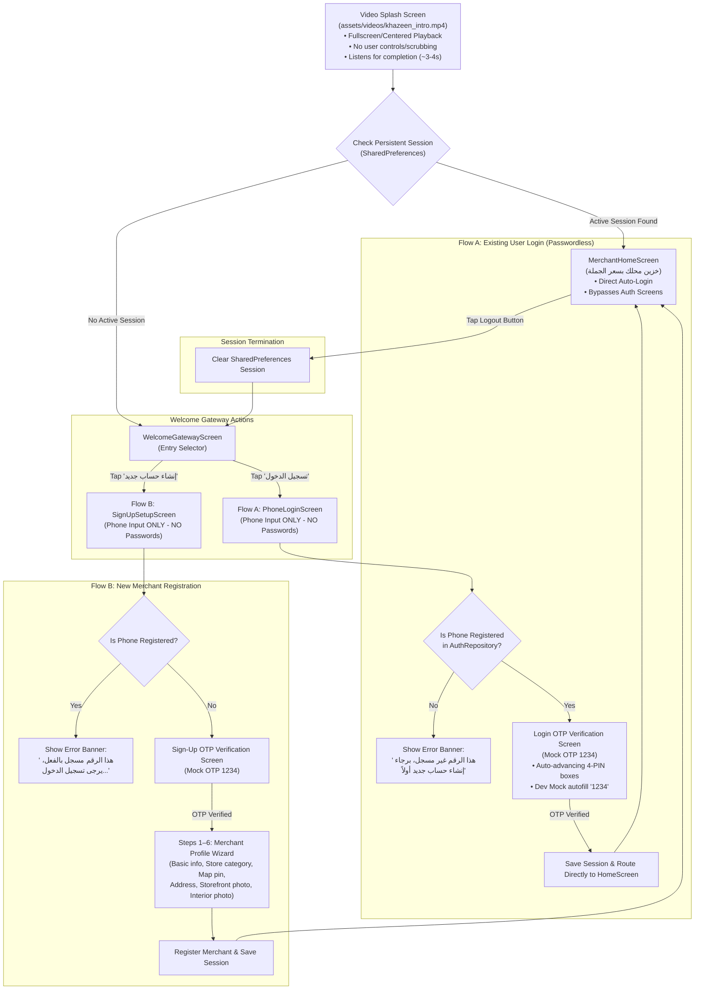

# Walkthrough: Unified Passwordless Authentication & Video Splash Screen

We have completed the architectural overhaul for **Khazeen** (خزين) mobile application:
1. **Video Splash Screen & Session Router**: Custom unboxing MP4 video (`assets/videos/khazeen_intro.mp4`) using `video_player`.
2. **Complete Removal of Passwords**: Both Login (Flow A) and Sign-Up (Flow B) rely 100% on **Egyptian Phone Number + 4-Digit SMS OTP (Mock 1234)**.

---

## 🏗️ Architecture & Navigation Flow Map



---

## 📱 Detailed Deliverables & Screen Implementations

### 1. Custom Unboxing Video Splash Screen (`AnimatedSplashScreen`)
- **Video Asset**:
  - Placed at `assets/videos/khazeen_intro.mp4`.
  - Configured in `pubspec.yaml` with `video_player: ^2.9.2`.
- **Playback & Lifecycle**:
  - Proportional & centered playback using `Center` and `FittedBox(fit: BoxFit.contain)` wrapping `AspectRatio(aspectRatio: _controller.value.aspectRatio, child: VideoPlayer(_controller))`.
  - Scaffold background set to `Color(0xFFEBEBEB)` matching the video's light gray background to ensure seamless letterboxing without black bars.
  - Completely hides user controls and scrubbing.
  - Listens to video completion (`position >= duration`).
  - Auto-routes to `MerchantHomeScreen` if user has an active session, or `WelcomeGatewayScreen` if not.
  - Built-in graceful fallback/timeout for headless test environments.

---

### 2. Welcome Gateway Screen (`WelcomeGatewayScreen`)
- **Top Half Area**:
  - Rich Emerald Wholesale Green gradient (`#128A56` to `#0C6840`).
  - Faint FMCG wholesale grocery tile grid pattern (beverages, detergents, canned goods, rice sacks).
  - Centered bold white **"خَزِين"** badge with wholesale slogan pill: `"كل نواقص محلك في مكان واحد"`.
- **Bottom Card**:
  - Pure white container with 24px top rounded corners.
  - Headline: `"أهلاً بيك في خزين"`.
  - Subtitle: `"سجّل دخولك أو اعمل حساب جديد واستمتع بعروض وأسعار الشركات لمحلك"`.
  - **Primary Button** (Solid `#128A56`): `"تسجيل الدخول"` ➔ routes to `PhoneLoginScreen`.
  - **Secondary Button** (Outlined `#128A56`): `"إنشاء حساب جديد"` ➔ routes to `SignUpSetupScreen`.

---

### 3. Flow A: Existing User Passwordless Login (`PhoneLoginScreen` & `OtpVerificationScreen`)
- **Screen A1: Phone Input (`PhoneLoginScreen`)**:
  - Top curved Emerald Green header with white "خزين" logo and back button.
  - Title: `"قم بتسجيل الدخول"`.
  - Subtitle: `"سجّل دخولك برقم هاتفك للمتابعة إلى حساب متجرك"`.
  - Single Input: `"رقم الهاتف"` with Egyptian prefix badge (`🇪🇬 +20`). Validates Egyptian numbers (010, 011, 012, 015 - 11 digits).
  - **STRICT: 100% passwordless — all password fields, eye toggles, and password checklist hints completely removed**.
  - Validation: If phone is not found in `AuthRepository`, displays explicit error banner:
    > **"هذا الرقم غير مسجل، برجاء إنشاء حساب جديد أولاً"**
  - Action Button: `"التالي"` ➔ navigates to Screen A2 (`OtpVerificationScreen(isLogin: true)`).
  - Quick Link: `"ليس لديك حساب؟ إنشاء حساب جديد"` ➔ navigates to Flow B.
  - Bottom customer support row: Call (19876) & WhatsApp chat options.
- **Screen A2: Login OTP Verification (`OtpVerificationScreen`)**:
  - Title: `"التحقق من رقم الهاتف 📱"`.
  - Subtitle: `"تم إرسال رمز تأكيد مكون من 4 أرقام إلى [رقم الهاتف]"`.
  - 4 auto-advancing PIN input boxes.
  - Mock OTP helper card with dev code `1234` and **`[ملء تلقائي]`** button.
  - On verification success: immediately saves session to `SharedPreferences` and routes directly to `MerchantHomeScreen`.

---

### 4. Flow B: New Merchant Registration (`SignUpSetupScreen` ➔ OTP ➔ 6-Step Wizard)
- **Step 0 (`SignUpSetupScreen`)**:
  - Title: `"إنشاء حساب تاجر جديد"`.
  - Input: Egyptian phone number only. NO password inputs.
  - Rejects already registered numbers with duplicate error banner.
  - Action: `"إرسال كود التحقق"` ➔ navigates to Step 0.5.
- **Step 0.5 (`OtpVerificationScreen(isLogin: false)`)**:
  - 4-digit PIN with mock code `1234`.
  - On verification success: proceeds directly to the 6-Step Merchant Setup Wizard.
- **Steps 1 to 6 (`MerchantRegistrationScreen`)**:
  1. البيانات: "الاسم بالكامل" و"إسم المنشأة".
  2. نوع المنشأة: اختيار من فئات البقالة والجملة.
  3. موقع المنشأة: دبوس الخريطة مع تلميح: "طلبك هيوصلك في العنوان ده".
  4. ادخال العنوان بالكامل: المحافظة والمدينة والشارع وأقرب علامة مميزة.
  5. صورة الواجهة: التقاط صورة من الخارج (مع زر "تخطي").
  6. صورة المحل من الداخل: التقاط صورة من الداخل (مع زر "تخطي").
  - Step 7: حفظ بيانات التاجر في `AuthRepository`، حفظ الجلسة، والانتقال للشاشة الرئيسية.

---

## 🧪 Verification Results

### 1. Static Analysis (`dart analyze lib test`)
```
Analyzing lib, test...
No issues found!
```
- 0 warnings, 0 errors across all 34 source and test files.

### 2. Automated Test Suite (`flutter test`)
All **24 tests passed** (100% pass rate):
1. `Egyptian Form & Password Security Validators Test Validates Egyptian phone numbers correctly`: **PASS**
2. `Egyptian Form & Password Security Validators Test Validates strict password security rules individually and combined`: **PASS**
3. `Egyptian Form & Password Security Validators Test Validates store and merchant names`: **PASS**
4. `Store Categories Test Contains 8 FMCG store categories with search`: **PASS**
5. `AuthRepository Persistent Session & Auto-Login Test Pre-seeded demo accounts exist in AuthRepository`: **PASS**
6. `AuthRepository Persistent Session & Auto-Login Test Session save, lookup, and clear works properly`: **PASS**
7. `AuthRepository & OnboardingViewModel Passwordless Flow Test Flow A: Unregistered phone triggers specific error banner message`: **PASS**
8. `AuthRepository & OnboardingViewModel Passwordless Flow Test Flow A: Registered phone validates successfully and completeLoginWithOtp saves session`: **PASS**
9. `AuthRepository & OnboardingViewModel Passwordless Flow Test Flow B: Step 0 phone validation and Step 0.5 OTP verification`: **PASS**
10. `AuthRepository & OnboardingViewModel Passwordless Flow Test Registration wizard completion persists new merchant in AuthRepository & saves session`: **PASS**
11. `Welcome Gateway Screen Test Renders all required elements matching design specifications`: **PASS**
12. `Welcome Gateway Screen Test Primary Button navigates to PhoneLoginScreen`: **PASS**
13. `Welcome Gateway Screen Test Secondary Button navigates to SignUpSetupScreen`: **PASS**
14. `AnimatedSplashScreen Startup Router & Auto-Login Test Routes to WelcomeGatewayScreen when no active session exists`: **PASS**
15. `AnimatedSplashScreen Startup Router & Auto-Login Test Bypasses auth and routes to MerchantHomeScreen when user is already logged in`: **PASS**
16. `Khazeen Multi-Step App Smoke Test Renders KhazeenApp without error`: **PASS**
17. `Flow A: Existing User Passwordless Login Tests PhoneLoginScreen renders all required elements without password fields`: **PASS**
18. `Flow A: Existing User Passwordless Login Tests Entering unregistered phone shows explicit error banner`: **PASS**
19. `Flow A: Existing User Passwordless Login Tests Entering registered phone navigates to Login OTP Screen`: **PASS**
20. `Flow A: Existing User Passwordless Login Tests OtpVerificationScreen in login mode verifies 1234 and routes to MerchantHomeScreen`: **PASS**
21. `Flow B: New Merchant Registration Phone Entry & Mock OTP Screens SignUpSetupScreen renders phone-only input and Send OTP CTA`: **PASS**
22. `Flow B: New Merchant Registration Phone Entry & Mock OTP Screens OtpVerificationScreen in registration mode routes to MerchantRegistrationScreen`: **PASS**
23. `Flow 3: Modular Permission Sheets Test Location permission modal displays expected content`: **PASS**
24. `Flow 3: Modular Permission Sheets Test Notification permission modal displays expected content`: **PASS**
